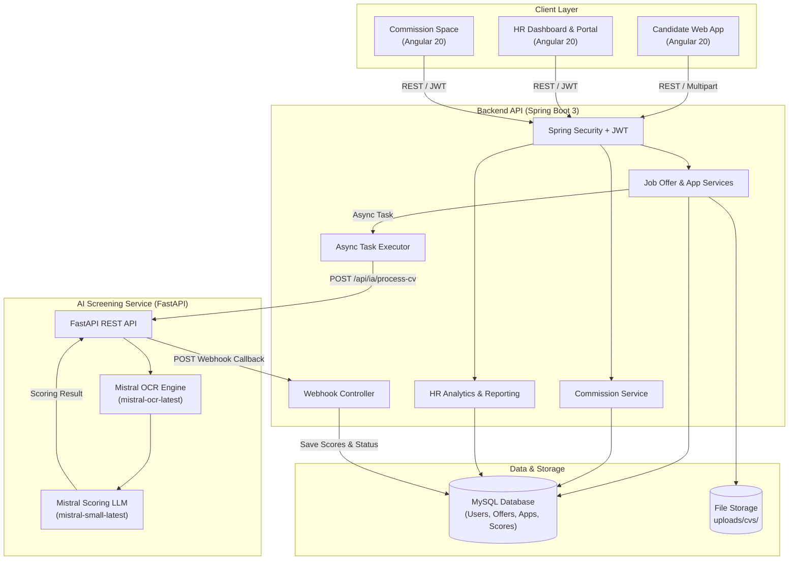

# 🎓 EPT Recruitment Platform (Plateforme de Recrutement - EPT)

[](https://spring.io/projects/spring-boot)
[](https://angular.dev/)
[](https://fastapi.tiangolo.com/)
[](https://mistral.ai/)
[](https://www.mysql.com/)
[](LICENSE)

An enterprise full-stack recruitment platform developed for **École Polytechnique de Thiès (EPT)**. It automates and streamlines the entire hiring cycle for teaching & research faculty (*PER*), administrative & technical staff (*PATS*), and contractual employees. The platform integrates an asynchronous AI-powered CV parsing and scoring engine leveraging **Mistral AI**.

---

## 📋 Table of Contents

- [System Architecture](#-system-architecture)
- [Key Features](#-key-features)
- [Tech Stack](#-tech-stack)
- [Repository Structure](#-repository-structure)
- [Prerequisites](#-prerequisites)
- [Getting Started & Installation](#-getting-started--installation)
  - [1. Backend Setup (Spring Boot)](#1-backend-setup-spring-boot)
  - [2. AI Service Setup (FastAPI & Mistral AI)](#2-ai-service-setup-fastapi--mistral-ai)
  - [3. Frontend Setup (Angular)](#3-frontend-setup-angular)
  - [4. Docker Compose Setup](#4-docker-compose-setup)
- [Environment Configuration](#-environment-configuration)
- [API Reference](#-api-reference)
  - [Authentication](#authentication)
  - [Job Offers (Public / Candidate)](#job-offers-public--candidate)
  - [Candidate Applications](#candidate-applications)
  - [HR Management](#hr-management)
  - [Evaluation Commissions](#evaluation-commissions)
  - [Commission Member Evaluations](#commission-member-evaluations)
  - [AI Webhook & Processing](#ai-webhook--processing)
- [Domain Enums & Data Models](#-domain-enums--data-models)
- [Troubleshooting](#-troubleshooting)
- [Contributing & Commit Conventions](#-contributing--commit-conventions)
- [Authors & License](#-authors--license)

---

## 🏗 System Architecture

The platform follows a modular microservice-inspired architecture:



---

## ✨ Key Features

### 🎓 For Candidates
- **Public Job Portal**: Search and filter published vacancies by keyword, employment category (*PER*, *PATS*, *CONTRACTUEL*), and contract type (*CDI*, *CDD*, *STAGE*).
- **Multi-Step Application Form**: Comprehensive application wizard capturing personal details, educational background, professional experience, motivation letters, GDPR consent, and electronic signature.
- **Resume Upload**: Secure upload of CVs in PDF or PNG format.
- **Application Tracking**: Real-time status monitoring (Submitted, Under Review, AI Scored, Shortlisted, Interview Scheduled, Accepted/Rejected).
- **Withdrawal**: Ability to retract an application while under review.

### 👥 For Human Resources (HR / RH)
- **Job Vacancy Lifecycle**: Create, edit, publish, suspend, and archive job postings with rich requirements and deadlines.
- **Applicant Pool Management**: Filter applicants by status, qualifications, and automated AI scoring threshold.
- **Commission Management**: Create evaluation commissions for specific job positions, assign members, and designate commission presidents.
- **Automated & Manual Shortlisting**: Advance top-ranking candidates into the commission review phase.
- **Executive Analytics Dashboard**: High-level KPIs, application volume charts, candidate distribution by contract type, and committee evaluation progress.

### ⚖️ For Commission Members
- **Assigned Applications**: Direct access to dossiers and resumes of candidates shortlisted for their specific commission.
- **Multi-Criteria Evaluation**: Rate candidates on key dimensions:
  - Technical Competence Score (1–5)
  - Experience Relevance Score (1–5)
  - Academic Diploma Score (1–5)
  - Motivation Score (1–5)
  - Soft Skills Score (1–5)
- **Reviewer Commentary**: Detailed justification and notes for final recruitment decisions.
- **Score Averaging**: Aggregated committee score calculation.

### 🤖 AI-Powered Resume Screening Engine
- **Mistral OCR Parsing**: High-precision extraction of structured resume data from unstructured PDFs (education history, work experiences, technical skills, tools, spoken languages, and certifications).
- **Multi-Criteria Matching**: Evaluates candidate qualifications directly against job offer requirements.
- **In-Depth Analysis**: Produces a global percentage score (0–100%), qualitative recommendation (*EXCELLENT*, *GOOD*, *AVERAGE*, *WEAK*), identified strengths, potential weaknesses, and missing skills.
- **Asynchronous Webhook Callbacks**: Non-blocking CV processing triggering automatic updates in the Spring Boot backend.

---

## 🛠 Tech Stack

| Component | Technology | Version / Notes |
|:---|:---|:---|
| **Frontend** | Angular | 20.3+ (Standalone Components, SSR, Signals) |
| **Frontend Styling** | Tailwind CSS / Angular Material | Modern, responsive UI |
| **Visualizations** | ApexCharts / ng-apexcharts | 2.0+ Interactive recruitment metrics |
| **Backend Framework** | Spring Boot | 3.x (Java 17+) |
| **Security** | Spring Security | Stateless JWT authentication & RBAC |
| **Database ORM** | Hibernate / Spring Data JPA | MySQL dialect |
| **Database** | MySQL | 8.0+ |
| **API Documentation** | Springdoc OpenAPI (Swagger 3) | Interactive documentation UI |
| **AI Framework** | FastAPI | 0.115+ (Python 3.11+) |
| **AI LLM / Vision** | Mistral AI SDK | Mistral OCR & Mistral Small LLM |
| **Data Validation** | Pydantic v2 | Strict JSON schema generation |
| **Containerization** | Docker & Docker Compose | Multi-container setup |

---

## 📁 Repository Structure

```text
recruitement-platform-ept/
├── Backend/                    # Spring Boot 3 REST API
│   ├── src/main/java/com/ept/sn/cri/backend/
│   │   ├── auth/              # JWT authentication & user accounts
│   │   ├── candidat/          # Candidate job browsing & submission
│   │   ├── commission/        # Commission member evaluations
│   │   ├── config/            # Security, OpenAPI & Async beans
│   │   ├── dashboard/         # HR analytics & KPI aggregates
│   │   ├── entity/            # JPA Entities (User, JobOffer, Application, etc.)
│   │   ├── enums/             # System enums (Status, Types, Roles)
│   │   ├── exception/         # Centralized GlobalExceptionHandler
│   │   ├── ia/                # AI Webhook & client integration
│   │   └── rh/                # HR job offers & commission administration
│   ├── src/main/resources/
│   │   └── application.properties # Spring configuration
│   ├── Dockerfile             # Multi-stage Maven + JRE 21 image
│   └── pom.xml                # Maven build configuration
├── Frontend/                   # Angular 20 Single Page Application
│   ├── src/app/
│   │   ├── api/               # Generated OpenAPI TypeScript client
│   │   ├── auth/              # Login, register & route guards
│   │   ├── candidat/          # Candidate portal & application views
│   │   ├── commission/        # Commission grading workspace
│   │   ├── features/          # Job offers list & multi-step application form
│   │   ├── layouts/           # Navigation & shell layouts
│   │   └── rh/                # HR dashboard & management components
│   ├── package.json           # Dependencies and Angular CLI scripts
│   └── angular.json           # Angular workspace configuration
├── ServiceIA_final/            # FastAPI AI CV Processing Service
│   ├── services/
│   │   ├── parsing.py         # Mistral OCR CV extraction
│   │   └── scoring.py         # Mistral LLM multi-criteria evaluation
│   ├── main.py                # FastAPI endpoints & lifecycle
│   ├── models.py              # Pydantic schemas (Request/Response)
│   ├── Dockerfile             # Python 3.11 container image
│   └── requirements.txt       # Python dependencies
├── uploads/                    # Local storage for uploaded candidate CVs
│   └── cvs/
├── docker-compose.yml          # Multi-container orchestration
└── Readme.md                  # Project documentation
```

---

## 📦 Prerequisites

Ensure the following tools are installed on your workstation:

- **Java JDK**: Version 17 or higher
- **Maven**: Version 3.8 or higher
- **Node.js**: Version 20.x or higher (`npm` included)
- **Python**: Version 3.10 or 3.11
- **MySQL Server**: Version 8.0 or higher
- **Mistral AI Account**: An active API Key from [Mistral AI Console](https://console.mistral.ai/)

---

## 🚀 Getting Started & Installation

### 1. Backend Setup (Spring Boot)

1. Navigate to the `Backend` directory:
   ```bash
   cd Backend
   ```

2. Configure environment credentials in `src/main/resources/application.properties` (or export environment variables):
   ```properties
   # Server
   server.port=8080
   server.servlet.context-path=/api/v1
   server.url=http://localhost:8080

   # Database Configuration
   spring.datasource.url=jdbc:mysql://localhost:3306/ept_recrutement?createDatabaseIfNotExist=true&useSSL=false&serverTimezone=UTC
   spring.datasource.username=root
   spring.datasource.password=your_db_password
   spring.datasource.driver-class-name=com.mysql.cj.jdbc.Driver

   # Hibernate / JPA
   spring.jpa.hibernate.ddl-auto=update
   spring.jpa.show-sql=false
   spring.jpa.properties.hibernate.dialect=org.hibernate.dialect.MySQLDialect

   # JWT Security
   application.security.jwt.secret_key=your_base64_encoded_256_bit_secret_key_here
   application.security.jwt.expiration=86400000

   # AI Microservice URL
   ia.service.url=http://localhost:8000
   ia.service.timeout=60000

   # File Upload Limits
   spring.servlet.multipart.max-file-size=10MB
   spring.servlet.multipart.max-request-size=10MB
   ```

3. Build and launch the backend:
   ```bash
   # Using Maven Wrapper
   ./mvnw clean spring-boot:run

   # Or standard Maven
   mvn clean spring-boot:run
   ```

4. The backend API is accessible at: `http://localhost:8080/api/v1`  
   Interactive Swagger UI documentation: `http://localhost:8080/swagger-ui/index.html`

---

### 2. AI Service Setup (FastAPI & Mistral AI)

1. Navigate to the `ServiceIA_final` directory:
   ```bash
   cd ServiceIA_final
   ```

2. Create and activate a Python virtual environment:
   ```bash
   # Linux / macOS
   python3 -m venv venv
   source venv/bin/activate

   # Windows
   python -m venv venv
   venv\Scripts\activate
   ```

3. Install required Python packages:
   ```bash
   pip install -r requirements.txt
   ```

4. Create an environment file `.env`:
   ```env
   MISTRAL_API_KEY=your_actual_mistral_api_key_here
   ```

5. Start the FastAPI server:
   ```bash
   # Development mode with hot-reload
   uvicorn main:app --reload --host 0.0.0.0 --port 8000
   ```

6. Verify service health:
   ```bash
   curl http://localhost:8000/health
   ```
   FastAPI Swagger UI: `http://localhost:8000/docs`

---

### 3. Frontend Setup (Angular)

1. Navigate to the `Frontend` directory:
   ```bash
   cd Frontend
   ```

2. Install dependencies:
   ```bash
   npm install
   ```

3. *(Optional)* Regenerate OpenAPI client services if backend DTOs have changed:
   ```bash
   npm run generate-api
   ```

4. Start the Angular development server:
   ```bash
   npm start
   # or
   ng serve --open
   ```

5. Open your browser and navigate to: `http://localhost:4200`

---

### 4. Docker Compose Setup

To start all services together using Docker:

```bash
docker-compose up --build
```

---

## ⚙ Environment Configuration

### Backend (`application.properties`)

| Key | Description | Default / Example |
|:---|:---|:---|
| `server.port` | Port for the Spring Boot application | `8080` |
| `server.servlet.context-path` | Context root prefix | `/api/v1` |
| `spring.datasource.url` | JDBC connection string | `jdbc:mysql://localhost:3306/ept_recrutement` |
| `spring.datasource.username` | Database user | `root` |
| `spring.datasource.password` | Database password | `******` |
| `application.security.jwt.secret_key` | Secret key for signing JWT tokens | `256-bit secret string` |
| `application.security.jwt.expiration` | Token lifespan in milliseconds (24h) | `86400000` |
| `ia.service.url` | URL pointing to the FastAPI service | `http://localhost:8000` |

### AI Service (`.env`)

| Key | Description | Required |
|:---|:---|:---|
| `MISTRAL_API_KEY` | Mistral AI API key used for OCR and Chat models | **Yes** |

---

## 📖 API Reference

Base URL: `http://localhost:8080/api/v1`

### Authentication

| Method | Endpoint | Access | Description |
|:---|:---|:---|:---|
| `POST` | `/auth/register/candidate` | Public | Register a new Candidate account |
| `POST` | `/auth/register/rh` | Public / Admin | Register an HR manager account |
| `POST` | `/auth/register/commission-member` | Public / Admin | Register a Commission member account |
| `POST` | `/auth/authenticate` | Public | Log in and obtain a JWT bearer token |

#### Example: Login Request
```http
POST /api/v1/auth/authenticate
Content-Type: application/json

{
  "email": "hr.officer@ept.sn",
  "password": "Password123!"
}
```

#### Example: Login Response
```json
{
  "token": "eyJhbGciOiJIUzI1NiIsInR5cCI6IkpXVCJ9...",
  "role": "RH"
}
```

---

### Job Offers (Public / Candidate)

| Method | Endpoint | Access | Description |
|:---|:---|:---|:---|
| `GET` | `/candidate/job-offers` | Public | List all published job vacancies |
| `GET` | `/candidate/job-offers/{id}` | Public | Get detailed requirements of a job offer |
| `GET` | `/candidate/job-offers/search?keyword={query}` | Public | Search vacancies by title or skills |
| `POST` | `/candidate/job-offers/{id}/apply` | `CANDIDATE` | Submit an application (`multipart/form-data`) |

#### Example: Job Application Submission
```http
POST /api/v1/candidate/job-offers/1/apply
Authorization: Bearer <CANDIDATE_JWT_TOKEN>
Content-Type: multipart/form-data

--boundary
Content-Disposition: form-data; name="cv"; filename="resume.pdf"
Content-Type: application/pdf

<binary_data>
--boundary
Content-Disposition: form-data; name="firstName"

Amadou
--boundary
Content-Disposition: form-data; name="lastName"

Diallo
--boundary
Content-Disposition: form-data; name="email"

amadou.diallo@example.com
--boundary
Content-Disposition: form-data; name="phoneNumber"

+221771234567
--boundary
Content-Disposition: form-data; name="highestDegree"

Master of Science
--boundary
Content-Disposition: form-data; name="majorField"

Computer Engineering
--boundary
Content-Disposition: form-data; name="motivationEcole"

Eager to contribute to EPT's excellence in polytechnic engineering education.
--boundary--
```

---

### Candidate Applications

| Method | Endpoint | Access | Description |
|:---|:---|:---|:---|
| `GET` | `/candidate/my-applications` | `CANDIDATE` | Retrieve user's application history |
| `GET` | `/candidate/my-applications/{id}` | `CANDIDATE` | View specific application details & current status |
| `DELETE`| `/candidate/my-applications/{id}` | `CANDIDATE` | Withdraw an application (if in allowed status) |

---

### HR Management

| Method | Endpoint | Access | Description |
|:---|:---|:---|:---|
| `GET` | `/rh/dashboard` | `RH` | Get aggregate KPI metrics, alert counters, and statistics |
| `GET` | `/rh/job-offers` | `RH` | List all job offers (including Draft, Suspended, Archived) |
| `POST` | `/rh/create-job-offers` | `RH` | Create a new job vacancy |
| `GET` | `/rh/job-offers/{id}` | `RH` | Get complete details of a specific job offer |
| `PUT` | `/rh/update-job-offers/{id}` | `RH` | Update an existing job vacancy |
| `DELETE`| `/rh/{id}` | `RH` | Delete or archive a job offer |
| `GET` | `/rh/applications/job-offer/{jobOfferId}` | `RH` | List applicants for a specific offer |
| `GET` | `/rh/applications/{applicationId}` | `RH` | Inspect complete candidate dossier & AI scores |
| `PUT` | `/rh/applications/{applicationId}/status` | `RH` | Manually update application progress status |
| `POST` | `/rh/applications/job-offer/{jobOfferId}/shortlist` | `RH` | Batch shortlist candidates for commission review |
| `GET` | `/rh/applications/job-offer/{jobOfferId}/stats` | `RH` | Statistical distribution of applicant qualifications |

#### Example: Create Job Offer
```http
POST /api/v1/rh/create-job-offers
Authorization: Bearer <HR_JWT_TOKEN>
Content-Type: application/json

{
  "jobTitle": "Assistant Professor in Machine Learning",
  "jobType": "PER",
  "typeContrat": "CDI",
  "description": "Teaching undergraduate & graduate courses in AI/ML and conducting applied research.",
  "requiredSkills": "Python, PyTorch, Deep Learning, MLOps, Research Publications",
  "niveauEtudeRequis": "Ph.D. / Doctorate",
  "experienceMin": 2,
  "dateLimite": "2026-12-31T23:59:59"
}
```

---

### Evaluation Commissions

| Method | Endpoint | Access | Description |
|:---|:---|:---|:---|
| `GET` | `/rh/commissions` | `RH` | List all evaluation committees |
| `POST` | `/rh/commissions` | `RH` | Create a new recruitment commission |
| `GET` | `/rh/commissions/{id}` | `RH` | Get commission members and assignments |
| `PUT` | `/rh/commissions/{id}` | `RH` | Update commission status or description |
| `POST` | `/rh/commissions/{id}/members` | `RH` | Add an evaluated member to the commission |
| `DELETE`| `/rh/commissions/{id}/members/{memberId}` | `RH` | Remove a member from the commission |
| `PUT` | `/rh/commissions/{id}/president/{memberId}` | `RH` | Designate commission president |
| `GET` | `/rh/commissions/get_all_commissions_members` | `RH` | Retrieve roster of all available evaluators |

---

### Commission Member Evaluations

| Method | Endpoint | Access | Description |
|:---|:---|:---|:---|
| `GET` | `/commission-member/my-commissions` | `COMMISSION_MEMBER` | List commissions assigned to current user |
| `GET` | `/commission-member/commissions/{id}/applications` | `COMMISSION_MEMBER` | List shortlisted applications to evaluate |
| `GET` | `/commission-member/commissions/{id}/applications/{appId}` | `COMMISSION_MEMBER` | Review candidate dossier & AI scores |
| `POST`| `/commission-member/commissions/{id}/applications/{appId}/evaluate` | `COMMISSION_MEMBER` | Submit multi-criteria evaluation |
| `PUT` | `/commission-member/commissions/{id}/applications/{appId}/evaluate` | `COMMISSION_MEMBER` | Update existing score & comment |
| `GET` | `/commission-member/commissions/{id}/applications/{appId}/my-evaluation` | `COMMISSION_MEMBER` | Retrieve my submitted score |
| `GET` | `/commission-member/commissions/{id}/applications/{appId}/cv` | `COMMISSION_MEMBER` | Download candidate's CV document |

#### Example: Submit Evaluation
```http
POST /api/v1/commission-member/commissions/3/applications/42/evaluate
Authorization: Bearer <COMMISSION_JWT_TOKEN>
Content-Type: application/json

{
  "competenceScore": 5,
  "experienceScore": 4,
  "diplomaScore": 5,
  "motivationScore": 4,
  "softSkillsScore": 4,
  "comment": "Outstanding research profile. Strong alignment with department curriculum."
}
```

---

### AI Webhook & Processing

| Method | Endpoint | Service | Description |
|:---|:---|:---|:---|
| `POST` | `/api/ia/process-cv` | FastAPI (`:8000`) | Trigger full OCR parsing and scoring pipeline |
| `POST` | `/api/v1/webhook/ia-result` | Spring Boot (`:8080`) | Webhook endpoint receiving async AI results |

#### AI Scoring Result Payload Example
```json
{
  "success": true,
  "application_id": 42,
  "scoring_result": {
    "score_global": 88.5,
    "matching_competences": 92.0,
    "matching_experience": 85.0,
    "matching_diploma": 90.0,
    "matching_motivation": 85.0,
    "justification": "Candidate has excellent qualifications in Deep Learning and required academic degrees.",
    "recommendation": "EXCELLENT",
    "strengths": [
      "Extensive experience with Python and PyTorch",
      "Doctorate in Computer Science",
      "Relevant academic publications"
    ],
    "weaknesses": [
      "Limited direct experience with Kubernetes / MLOps in production"
    ],
    "missing_skills": ["Kubernetes"]
  },
  "error_message": null,
  "total_processing_time": 4.85
}
```

---

## 📊 Domain Enums & Data Models

### User Roles (`Role`)
- `CANDIDATE`: Job seeker submitting applications.
- `RH`: Human Resources officer managing postings, commissions, and workflows.
- `COMMISSION_MEMBER`: Committee member reviewing and grading candidates.
- `ADMIN`: Platform administrator.

### Job Offer Status (`JobStatus`)
- `DRAFT`: Draft mode, not visible to candidates.
- `PUBLISHED`: Active and accepting applications.
- `SUSPENDED`: Temporarily halted.
- `ARCHIVED`: Closed permanently.

### Job Category (`JobType`)
- `PER`: *Personnel d'Enseignement et de Recherche* (Teaching and Research Faculty).
- `PATS`: *Personnel Administratif, Technique et de Service* (Administrative & Technical Staff).
- `CONTRACTUEL`: Short/Long-term Contractual Personnel.

### Contract Types (`ContratType`)
- `CDI`: *Contrat à Durée Indéterminée* (Permanent Contract).
- `CDD`: *Contrat à Durée Déterminée* (Fixed-Term Contract).
- `STAGE`: Internship.

### Application Status (`ApplicationStatus`)
`DRAFT` ➔ `SUBMITTED` ➔ `UNDER_REVIEW` ➔ `AI_SCORED` ➔ `SHORTLISTED` ➔ `INTERVIEW_SCHEDULED` ➔ `INTERVIEW_COMPLETED` ➔ `ACCEPTED` / `REJECTED` / `WITHDRAWN`

---

## 🐛 Troubleshooting

### 1. `MISTRAL_API_KEY is missing`
Ensure your `ServiceIA_final/.env` file exists and contains `MISTRAL_API_KEY=...`. Check permissions and verify that python-dotenv is loading properly.

### 2. Spring Boot cannot connect to MySQL
- Confirm that MySQL is running on port 3306.
- Verify user credentials and database existence (`ept_recrutement`).
- Verify `spring.datasource.url` parameters.

### 3. File upload errors (`MaxUploadSizeExceededException`)
Increase the max file size limits in `Backend/src/main/resources/application.properties`:
```properties
spring.servlet.multipart.max-file-size=15MB
spring.servlet.multipart.max-request-size=15MB
```

### 4. CORS errors in Angular
Backend has global CORS configuration enabled via `WebConfig.java`. Ensure Angular's API calls target `http://localhost:8080/api/v1`.

---

## 🤝 Contributing & Commit Conventions

When contributing to this repository, please adhere to standard **Conventional Commits** in **English**:

```text
<type>(<scope>): <short summary in English>

[optional body]
```

### Allowed types:
- `feat`: A new feature or endpoint
- `fix`: A bug fix
- `docs`: Documentation changes (e.g. README updates)
- `style`: Formatting, missing semicolons, etc. (no code logic changes)
- `refactor`: Refactoring production code without behavior changes
- `test`: Adding or updating tests
- `chore`: Updating build scripts, dependencies, or configuration

### Contribution workflow:
1. Fork or create a feature branch: `git checkout -b feat/ai-scoring-refinement`
2. Make your edits following English variable naming conventions.
3. Commit with an English message: `git commit -m "feat(ia): improve cv parsing precision for bilingual resumes"`
4. Push and open a Pull Request.

---

## 👨‍💻 Authors & License

Developed as part of the digital transformation and recruitment management system for **École Polytechnique de Thiès (EPT)**:
- **Mouhamadou Aliou BA** – [bmouhamadoualiou@ept.sn](mailto:bmouhamadoualiou@ept.sn)
- **Fa Syaka Diouf** – [fsd@ept.sn](mailto:fsd@ept.sn)

This project is licensed under the [MIT License](LICENSE).
